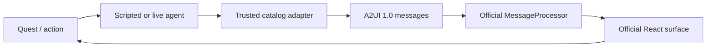

# Goblin Market

A small, playful demonstration of [A2UI](https://a2ui.org/quickstart/): an opinionated goblin shopkeeper helps you prepare for an absurd quest.

Tell Grimble you're fighting a dragon. Add a fireproof umbrella and a little liquid courage. Haggle. Then say: **“Actually, the dragon is my date.”** The shop changes to gifts and a date-preparation checklist.

## Run locally

Requires Node.js 22+ and npm.

```sh
npm ci
npm run dev
```

Open the local URL Vite prints. No API key is required. For a production static build:

```sh
npm test
npm run build
```

Serve `dist/` with your preferred static host. `.openai/hosting.json` is the existing Sites deployment identity; use your own hosting configuration when deploying a separate instance.

## What is real A2UI here?

The app uses the official **`@a2ui/web_core` 0.15.0** message processor and **`@a2ui/react` 0.15.0** renderer with the **A2UI 1.0** wire protocol. All shop content inside the surface is instantiated by the SDK from catalog-approved component messages; React supplies the component implementations. The navigation, chat, and inspector are ordinary application UI.

- **Catalog:** eight custom component types with Zod schemas, dynamic bindings, child references, and declared actions.
- **`createSurface`:** registers the shop with its component tree and initial data model.
- **`updateDataModel`:** updates quantities, gold, discount, and totals without replacing the tree.
- **`updateComponents`:** changes the available wares and adds/removes the date checklist and receipt.
- **Actions:** add/remove, filter, sort, haggle, accept/decline, purchase, and dismiss are dispatched by the SDK to the agent controller.
- **Local bindings:** the date approach and checklist update through the SDK's generated setters without an agent call.

**Behind the magic** shows the actual processed messages, live data model, and exported catalog. You can copy JSON or download the message log as JSONL. API keys are never included in logs.



## Two agent modes

**Scripted demo** is the default and is visibly labeled in the app. It supports dragon battles, dragon dates, stealth heists, and forest adventures. It is deterministic, browser-local, and requires no external service. This is a protocol demonstration, not an LLM running secretly behind the scenes.

**Live AI** is optional: click **Configure** under the chat composer, enter your OpenAI API key and a model supporting Chat Completions JSON mode (default `gpt-4.1-mini`), then connect. Requests go directly from the browser to `api.openai.com`. The key exists only in the current tab's React memory; it is not persisted, logged, or sent to the hosting server. OpenAI bills usage to your account. The live mode needs a working key and has not been exercised with a billed API account as part of the no-key demo checks.

The model returns a constrained plan (`mode`, `message`, `itemIds`, `budget`). A trusted adapter compiles that plan into the approved A2UI components. This deliberately small example demonstrates agent-selected layouts; it does not ask the model to invent arbitrary HTML or raw A2UI trees. Item prices, quantities, discount arithmetic, and purchase validation stay in code. In a production commerce app, enforce those rules on a server.

## Demo in two minutes

1. Start in the dragon-survival quest with 50 gold.
2. Add **Fireproof Umbrella** and two **Liquid Courage** potions: 32 gold.
3. Open **Behind the magic → Messages**: show the action and `updateDataModel` messages.
4. Haggle and accept: save 6 gold, total 26. Buy: balance becomes 24 and a receipt lists your equipment.
5. Click **Plot twist: it’s a date.** Show the gift selection and new date checklist.
6. Check a preparation item; open **Data model** to show the local bound value.
7. Click the reset icon by **At the counter** to begin again.

## Source map

| File | Responsibility |
| --- | --- |
| `src/domain.mjs` | Inventory, quest planning, search, cart arithmetic, and action rules |
| `src/protocol.jsx` | Catalog schemas, React implementations, data bindings, A2UI messages |
| `src/main.jsx` | App shell, agent loop, optional OpenAI connection, inspector |
| `src/art.jsx` | Original SVG illustrations |
| `src/style.css` | Responsive visual design and reduced-motion support |
| `test/` | Cart behavior and validation with the real A2UI processor |

Tests cover quantity limits, unknown items, discount acceptance, overspending, checkout receipts, budget/allergy filtering, sorting, all four quest trees, data updates, and rejecting components outside the catalog. They test the processor without a browser; they do not substitute for a renderer integration test.

Session state is intentionally ephemeral: refreshing resets the shop and forgets the API key. No payments, accounts, or database are involved.

## License

Apache-2.0. See [LICENSE](LICENSE). A2UI is an Apache-2.0 project by Google and contributors; its packages retain their own notices.
